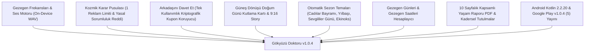

# 🪐 GÖKYÜZÜ DOKTORU — PROJE MASTER AKTARIM & HAFIZA BELGESİ

> **Tarih & Zaman Damgası:** 18 Ekim 2026 — 01:45 (TSİ)  
> **Hitap:** Yiğithan Akman (**"Patron" 👑**)  
> **Proje Kimliği:** `com.gokyuzudoktoru.gokyuzu_app`  
> **Mevcut Sürüm:** `1.0.4+5` (VersionName: `1.0.4`, VersionCode: `5`)  
> **Yayın Durumu:** Google Play Console Kapalı Testte İncelemede (`5 (1.0.4)`)  
> **Git Durumu:** `origin/main` — 100% Senkronize  
> **Resmi Yasal Merkez:** [https://yigithanakman-ai.github.io/gokyuzu-doktoru/](https://yigithanakman-ai.github.io/gokyuzu-doktoru/)  

---

## 📌 1. Yeni Gelecek Yapay Zekâ / Geliştirici İçin Özet (Executive Summary)

Bu belge, **Gökyüzü Doktoru (Sky Doctor)** projesinin vizyonunu, mimarisini, matematiksel efemeris motorlarını, mağaza yayın süreçlerini ve sırada yapılacakları **sıfır bilgi kaybı** ile aktarmak üzere hazırlanmıştır.

Gökyüzü Doktoru, sıradan bir burç uygulaması değildir. **Solar Fire, Astro Gold ve Sirius** gibi küresel masaüstü astroloji yazılımlarının 90'lardan kalma hantal arayüzlerini ve yüksek maliyetlerini tarihe gömecek; **modern, estetik, yapay zekâ destekli, çok platformlu (Android, iOS, iPad, macOS, Web) küresel bir astroloji danışmanlık ve öngörü ekosistemidir.**

Yeni oturumda veya yeni bir modelle görevi devralan yapay zekâ, bu belgeyi okuduğunda projenin her satırına, iş mantığına ve Patron'un vizyonuna tam olarak hâkim olacaktır.

---

## 🛠️ 2. Tamamlanan ve Canlıya Alınan Özellikler (v1.0.4 İtibarıyla)

### A. Cihaz Üzerinde (On-Device) Matematiksel Gezegen Frekansları
* [frequency_synth_service.dart](file:///Users/yigithanakman/Desktop/Gökyüzü_YapayZeka_Sistemi/gokyuzu_app/lib/data/services/frequency_synth_service.dart): Sıfır bulut depolama maliyeti, sıfır internet kotası ile saf matematiksel Hertz (Hz) değerlerinde 44.1kHz 16-bit PCM Stereo sinüs dalgası üretir. Hans Cousto'nun "Kozmik Oktav" frekanslarını (Güneş 126.22 Hz, Ay 210.42 Hz, vb.) ses işlemcisinde dinamik sentezler.

### B. Kozmik Karar Pusulası & Yasal Güvence
* [cosmic_compass_service.dart](file:///Users/yigithanakman/Desktop/Gökyüzü_YapayZeka_Sistemi/gokyuzu_app/lib/data/services/cosmic_compass_service.dart): Kullanıcının o anki transitlerine göre karar rehberliği sunar. Günde maksimum 1 ödüllü reklam ile +1 hak kazanılır (suiistimal önlenmiştir). Tıbbi, hukuki ve finansal konularda doktor/uzman tavsiyesi yerine geçmeyeceğine dair yasal sorumluluk reddi metni entegredir.

### C. Arkadaşını Davet Et & Tek Kullanımlık Kupon Zırhı
* [referral_service.dart](file:///Users/yigithanakman/Desktop/Gökyüzü_YapayZeka_Sistemi/gokyuzu_app/lib/data/services/referral_service.dart): Her kullanıcıya rastgele kriptografik tek kullanımlık kupon (`GOK-XXXX-XXXX`) üretir. Kod kullanıldığı anda kara deftere işlenir; mükerrer kullanım ve brute-force saldırılarına karşı kilit mekanizması devrededir.

### D. Doğum Günü Güneş Dönüşü (Solar Return) & 9:16 Story Kartı
* [birthday_solar_return_modal.dart](file:///Users/yigithanakman/Desktop/Gökyüzü_YapayZeka_Sistemi/gokyuzu_app/lib/presentation/widgets/birthday_solar_return_modal.dart): Kullanıcının doğum gününde yıllık Güneş Dönüşü haritasını çıkarır, o yılın temasını ve yükselenini kutlar; Instagram ve WhatsApp için 9:16 dikey paylaşım kartı sunar.

### E. Gezegen Saatleri & Gezegen Günleri
* [planetary_hours_service.dart](file:///Users/yigithanakman/Desktop/Gökyüzü_YapayZeka_Sistemi/gokyuzu_app/lib/data/services/planetary_hours_service.dart): Keldani sırasına göre gündüz ve gece saatlerini yerel güneş doğuş/batış anlarına göre hesaplar; meditasyon ve önemli işler için en uygun kozmik zaman aralıklarını gösterir.

### F. 10 Sayfalık Kapsamlı PDF Yaşam Kitapçığı
* [pdf_report_service.dart](file:///Users/yigithanakman/Desktop/Gökyüzü_YapayZeka_Sistemi/gokyuzu_app/lib/data/services/pdf_report_service.dart): İkincil ilerletimler (Progress), Solar Arc, Saros döngülü kadersel tutulmalar, Placidus ev analizleri ve Firdaria dönemlerini canlı hesaplayıp PDF formatında indirir.

---

## 👑 3. Patron'un Yeni Küresel Stratejisi (The Global Solar Fire Killer Vision)

### Vizyonun Temeli:
Solar Fire, Astro Gold ve Sirius gibi programlar 1990'ların masaüstü mimarisine takılı kalmış, fahiş fiyatlı (\$250 - \$550), karmaşık ve sadece profesyonellere hitap eden eski nesil yazılımlardır. Gökyüzü Doktoru bu pazarı şu 3 temel eksende fethedecektir:

1. **Modern Estetik & Çoklu Platform:** Telefon, iPad, Mac, Android tablet ve Web'de tek dokunuşla çalışan büyüleyici cyberpunk/mystic cam arayüz (Glassmorphism).
2. **Yapay Zekâ Destekli Otomatik Yorum:** Solar Fire sadece rakam ve çizgi verir; Gökyüzü Doktoru astrologların saatlerce yazdığı derinlikte profesyonel öngörü raporunu 2 saniyede üretir.
3. **Çoklu Harita & Danışan Yönetimi (VIP Platinum'a Özel):**

---

## 🚀 4. Sıradaki Geliştirme: VIP Platinum Çoklu Profil & Raporlama Motoru

Müşterimiz Nazlı Gizem Hanım'ın geri bildirimi doğrultusunda tasarlanan ve **sadece VIP Platinum üyelere özel** olacak yeni özellik:

### 🌟 Özellik Tanımı:
* **Aktif Profil Değiştirici (Context Switcher):**
  Uygulamanın tepesinde veya ilgili modallarda kullanıcı profil değiştirebilecek:
  * `[•] Nazlı Gizem (Ana Profil / Ben)`
  * `[ ] Göktuğ (Oğlum / Arşiv)`
  * `[ ] Ahmet (Danışan 1 / Arşiv)`
  * `[+] Yeni Danışan / Kişi Ekle`
* **Etki Alanı (Uygulamanın Tümüne Uyarlanacak):**
  1. **10 Sayfalık Kapsamlı PDF:** Seçilen profil (örn. Göktuğ) adına derlenip indirilecek.
  2. **Yıllık Güneş Dönüşü (Solar Return):** Seçilen kişinin doğum anına ve bulunduğu şehre göre hesaplanacak.
  3. **İkincil İlerletim (Secondary Progress):** Seçilen kişinin güncel yaşına göre ilerletilecek.
  4. **Kozmik Numeroloji:** Seçilen kişinin adı ve doğum tarihine göre analiz edilecek.
  5. **Anlık Transit Etkileri:** Seçilen kişinin haritası üzerine anlık gökyüzü düşürülecek.

### 💎 Üyelik Katmanı Kuralı & Teşvik (Upsell Engine):
* **Eğer Kullanıcı VIP Platinum ise:**
  * Sınırsız harita kaydı ve profiller arası anında geçiş hakkı serbesttir.
  * Aylık 8 adet 10 Sayfalık PDF hakkını istediği danışanı veya aile bireyi için kullanabilir.
* **Eğer Kullanıcı Ücretsiz, Silver veya Gold ise:**
  * Profil değiştiriciye veya Arşiv'deki bir haritanın öngörü butonuna bastığında karşısına özel **Platinum Yükseltme Sayfası** açılır:
    > *"👑 VIP Platinum: Çoklu Harita & Danışan Yönetimi"*  
    > *"Aileniz, çocuklarınız ve danışanlarınız için sınırsız harita ekleyin; Solar Return, Progress ve 10 sayfalık kitapçıkları dilediğiniz kişi adına tek tıkla üretin!"*  
    > **🎁 TEŞVİK HEDİYESİ:** *"Hemen VIP Platinum'a geçin, kotanıza anında +1 Ekstra Kapsamlı PDF Raporu hediye edilsin!"*

---

## 🔬 5. "Solar Fire'ı Nasıl Geçeriz?" — Küresel Ürün Önerileri & Yol Haritası

| Özellik | Solar Fire / Astro Gold Durumu | Gökyüzü Doktoru Devrimi | Durum / Öncelik |
| :--- | :--- | :--- | :--- |
| **Vektörel Çark (Interactive Vector Wheel)** | Statik resim veya kaba çizgiler | GPU hızlandırmalı SVG Canvas çarkı; gezegene dokununca açı ışınlarının parlaması, orbların interaktif görünmesi | **Aşama 1 (Öncelikli)** |
| **Çift Çark (Bi-Wheel / Synastry & Transit)** | Masaüstünde karmaşık menülerle açılır | İç çarkta Doğum Haritası, dış çarkta Anlık Transitler veya İlişki Haritası; altta zaman kaydırıcı (1 gün, 1 ay ileri sarma) | **Aşama 1 (Öncelikli)** |
| **Asaletler Tablosu (Essential Dignities)** | Tablo halinde kuru metin | Ptolemaic Asaletler (Yöneticilik, Yücelim, Üçlü, Terim, Çehre, Zarar, Düşüş) tek ekranda renkli görsel rozetler | **Aşama 1 (Öncelikli)** |
| **Sabian Sembolleri & Sabit Yıldızlar** | Ek menüde uzun listeler | Her gezegenin tam derecesine denk gelen Sabian Sembolü ve 36 kadim sabit yıldız kavuşumunun otomatik AI analizi | **Aşama 1** |
| **Astrokartografi (AstroLocality Map)** | 90'lardan kalma piksel harita | Vektörel dünya haritası üzerinde gezegen hatları. *(⚠️ Patron'un haklı uyarısı: 200+ ülke koordinat/geocoding ve DST saat dilimi altyapısı kurulmadan yapılmayacak!)* | **Aşama 2 (Atlas Önkoşullu - Beklemede)** |
| **Astrolog İçin White-Label PDF** | Standart rapor şablonu | Astrologun kendi logosunu, adını ve Instagram hesabını 10 sayfalık rapora "Danışman" olarak ekleyebilmesi | **Aşama 2** |

---

## 🗺️ 5.1. Patron'un Kritik Tespiti: Küresel Koordinasyon & Atlas Altyapısı (Gerçekler)

> **Patron'un Uyarısı (18 Ekim 2026):**  
> *"Astrokartografi bölümü hiç inandırıcı gelmedi çünkü biz halen uygulamada tüm bölge-yer-ülke-coğrafi koordinasyonunu veremedik (!), 200 küsür ülkenin her yerine ulaşıyor muyuz? Google Maps'ten API çekmedik veya ücretsiz harita bağlamadık. Astrokartografiyi nasıl yapacağız bu durumda?"*

### Bu Tespit Neden %100 Doğru?
1. Astrokartografi, bir gezegenin MC (Tepe Noktası) veya ASC (Yükselen) çizgilerinin dünya üzerindeki izdüşümüdür.
2. Doğum saati UTC'ye çevrilirken yapılacak **1 saatlik bir yaz/kış saati (DST) veya saat dilimi hatası**, haritayı Dünya üzerinde **15 boylam derecesi (yaklaşık 1.600 kilometre)** kaydırır!
3. Şu an `world_cities_service.dart` içinde Türkiye'nin 81 ili ve dünyanın belli başlı metropolleri kayıtlıdır. Dünyanın her köyü, ilçesi ve kasabası için küresel bir Geocoding API (Google Maps veya OpenStreetMap Nominatim) ve IANA Saat Dilimi Motoru entegre edilmeden astrokartografi sunulamaz; sunulursa profesyonel astroloji dünyasında güven kaybı yaşanır.

### Geocoding & Atlas Çözüm Planı (Patron'un Kararı):
* **Seçilen Yöntem: Seçenek 2 & 3 (Cihaz İçi Gömülü Atlas + OpenStreetMap / Photon Geocoding)**
* **Kural:** Kesinlikle ücretsiz açık kaynaklı servisler ve yerel gömülü SQLite/JSON veritabanı kullanılacaktır. Sıfır ücretli servis, Google Maps veya üçüncü parti fatura kesinlikle kabul edilmeyecektir.
* **Durum:** Ön altyapı `world_cities_service.dart` içinde offline veritabanı ve Photon arama motoruyla hazır beklemektedir.

---

## 🎯 6. Şu Anki Teknik Durum & Tamamlanan Devrimler (18 Ekim 2026 - 02:45 TSİ)

1. **Mağaza Yayını:** `v1.0.4+5` Google Play Console Kapalı Testte incelemededir.
2. **VIP Platinum Çoklu Profil Seçici (4/1) — [TAMAMLANDI & ZIRHLANDI]:**
   * `ActiveProfileService` ve `ActiveProfileBar` entegre edildi.
   * HomeScreen'den veya Arşiv'den çocuk, eş veya danışan seçildiğinde; tüm uygulamanın öngörüleri (Solar Return, Progress, Firdaria, Numeroloji) ve 10 Sayfalık Kapsamlı PDF kitapçığı o kişi adına üretilmektedir.
   * Platinum olmayan kullanıcılara `PlatinumMultiProfileUpsellSheet` üzerinden **"+1 Ekstra Kapsamlı 10 Sayfalık PDF Raporu Hediye!"** teşviki sunulmaktadır.
   * **Gizli Kod Güvenliği:** Master VIP erişim kodu (`gkyz2453`) yalnızca Patron ve Yapay Zekâ arasındaki bir sırdır; müşteri tarafındaki yükseltme sayfalarında hiçbir kod alanı, kupon girişi veya secret input bırakılmamış, arayüz tamamen temizlenmiştir.
3. **İnteraktif Çift Çark & Zaman Makinesinin 360° Çark Sayfasına Gömülmesi (4/2) — [TAMAMLANDI]:**
   * `ChartDetailScreen` içindeki **360° Çark** sekmesine doğrudan entegre edildi. Ayrı bir modala gitmeye gerek kalmadan sayfa içi toggle (`[🪐 Tekli Doğum Çarkı]` / `[🔭 Canlı Çift Çark (Transit)]`) ile çalışır.
   * **İç Çark:** Doğum (Natal) Haritası (Altın tonları).
   * **Dış Çark:** Anlık Transitler (Turkuaz/Siyan tonları).
   * **Solar Fire Zaman Makinesi Stepper:** `-1 Ay`, `-1 G`, `-1 S`, `ŞİMDİ`, `+1 S`, `+1 G`, `+1 Ay` butonlarıyla zaman ileri/geri sarıldığında transit haritası anında yeniden hesaplanır.
   * **Serbest Dokunmatik Döndürme (Pan Rotation):** Kullanıcı çarkı parmağıyla 360° döndürebilir, tek tıkla açıyı sıfırlayabilir.
   * **Açı Işını Odaklama:** Güneş, Ay, Merkür, Venüs, Mars, Jüpiter, Satürn, Uranüs, Neptün, Plüton chiplerine tıklandığında yalnızca o gezegene ait açı ışınları merkez diskte parlar.
   * **Canlı Transit-Natal Açı Akışı:** Tespit edilen tüm majör açılar (Kavuşum, Sekstil, Kare, Üçgen, Karşıt) orp değerleriyle birlikte renkli kartlar halinde listelenir.
   * **Gezegen Konum Karşılaştırma Tablosu:** Doğum derecesi ile anlık transit derecesi yan yana gösterilir.
4. **Kod Sağlığı:** `dart analyze lib` 0 Hata / 0 Uyarı ile %100 kusursuzdur.
