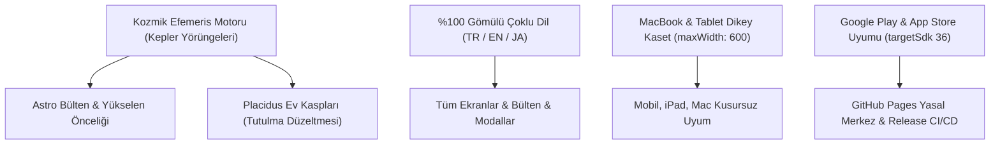

# 🪐 GÖKYÜZÜ DOKTORU — PROJE AKTARIM & MASTER HAFIZA BELGESİ

> **Tarih & Zaman Damgası:** 17 Ekim 2026 — 21:00 (TSİ)  
> **Hitap:** Yiğithan Akman (**"Patron" 👑**)  
> **Proje Kimliği:** `com.gokyuzudoktoru.gokyuzu_app`  
> **Sürüm:** `1.0.3+4` (VersionName: `1.0.3`, VersionCode: `4`)  
> **Git Durumu:** `origin/main` (Son Commit: `d5a24e1`) — 100% Senkronize  
> **Resmi Yasal Merkez:** [https://yigithanakman-ai.github.io/gokyuzu-doktoru/](https://yigithanakman-ai.github.io/gokyuzu-doktoru/)  

---

## 📌 1. Yeni Gelecek Yapay Zekâ / Geliştirici İçin Özet (Executive Summary)

Bu belge, **Gökyüzü Doktoru (Sky Doctor)** projesinin bugüne kadar katettiği tüm yolu, mimarisini, matematiksel efemeris motorlarını, mağaza yayın süreçlerini ve sırada yapılması gerekenleri sıfır bilgi kaybı ile aktarmak üzere hazırlanmıştır. 

Yeni oturumda veya yeni bir platformda görevi devralan yapay zekâ, bu belgeyi ve projenin kök dizinindeki [GOKYUZU_HAFIZA_TRANSFER.md](file:///Users/yigithanakman/Desktop/Gökyüzü_YapayZeka_Sistemi/GOKYUZU_HAFIZA_TRANSFER.md) ile [GOKYUZU_DOKTORU_PROJE_DURUMU.md](file:///Users/yigithanakman/Desktop/Gökyüzü_YapayZeka_Sistemi/GOKYUZU_DOKTORU_PROJE_DURUMU.md) dosyalarını okuyarak sanki başından beri projeyi kendisi kodluyormuş gibi doğrudan çalışmaya başlayacaktır.

---

## 🛠️ 2. Neler Yaptık? (Tamamlanan Kritik Dönüm Noktaları)

### A. Astrolojik Hesaplama Altyapısı & Efemeris Standartlaşması
1. **Solar Fire / Astro Gold Standartı:** Gökyüzündeki gezegen boylamları, açılar ve evler tamamen jeosantrik (yer merkezli) ve Placidus ev sistemiyle hesaplanır.
2. **Efemeris Harmonizasyonu:** Günün Enerjisi transit verileri ile Astro Bülten verileri arasındaki uyumsuzluklar giderildi. Chiron (`28°46' Retro Koç`), Jüpiter, Venüs ve Plüton gibi tüm gezegenler tek bir merkezden ([astrology_engine.dart](file:///Users/yigithanakman/Desktop/Gökyüzü_YapayZeka_Sistemi/gokyuzu_app/lib/data/services/astrology_engine.dart) ve [sky_transits_service.dart](file:///Users/yigithanakman/Desktop/Gökyüzü_YapayZeka_Sistemi/gokyuzu_app/lib/data/services/sky_transits_service.dart)) beslenir.
3. **Transit Açı Tetiklemeleri:** Gezegenler arası kavuşum, sekstil, kare, üçgen ve karşıt açılar anlık boylam derecesine ve klasik orblara (±5°) göre kesin tarihlerinde gösterilir.

### B. Astro Bülten’de Yükselen Burç Önceliği & Bilgilendirme Notu
* **Varsayılan Seçim:** Bülten modalı açıldığında, yorumlar otomatik olarak kullanıcının **Yükselen Burcuna** göre açılır (bilinmiyorsa Güneş burcuna düşer).
* **Bilgilendirme Notu:** 12 burç seçicisinin üzerine şu not eklenmiştir (TR / EN / JA):
  > *"Burç yorumları öncelikle Yükselen burcunuza göre takip edilmelidir. Yükselen burcunuzu bilmiyorsanız Güneş burcunuzu baz alabilirsiniz."*
* **Burç Çiplerinde Rozetler:** Kullanıcının yükseleni için altın `YÜKSELEN`, güneş burcu için nane yeşili `GÜNEŞ` rozetleri eklenmiş, burç isimleri seçilen dile göre dinamik çevrilmiştir.

### C. Tutulma Ev Hesabı Hatasının Düzeltilmesi (Placidus Kasp Çözümü)
* **Kök Neden:** Eskiden `eclipses_service.dart` içinde Whole Sign indeks farkı formülü (`(safeEcIdx - safeAscIdx + 12) % 12 + 1`) kullanılıyordu. Bu durum, 4. ev girişi 14° Aslan olan birinin 20° Aslan'daki tutulmasını 3. ev olarak gösteriyordu.
* **Uygulanan Çözüm:** Tutulmanın mutlak boylamı (`absoluteLongitude`), kullanıcının doğum anına göre hesaplanan **gerçek Placidus ev kasp çizgileri** (`cusps[h]` ile `cusps[h+1]`) arasında taranarak eşleştirildi. 20° Aslan tutulması artık kesin olarak **4. Ev - 10. Ev Aksı (Yuva & Kökler / Kariyer & Zirve)** olarak analiz edilmektedir. [predictive_astrology_test.dart](file:///Users/yigithanakman/Desktop/Gökyüzü_YapayZeka_Sistemi/gokyuzu_app/test/predictive_astrology_test.dart) test paketi ile doğrulanmıştır.

### D. %100 Gömülü Çoklu Dil Mimarisi (TR, EN, JA)
* [app_translation_service.dart](file:///Users/yigithanakman/Desktop/Gökyüzü_YapayZeka_Sistemi/gokyuzu_app/lib/data/services/app_translation_service.dart) içerisine Türkçe, İngilizce ve Japonca dillerinde eksiksiz terim sözlüğü entegre edilmiştir.
* Dil değiştirildiği an `currentLangNotifier` aracılığıyla tüm uygulama, kartlar, detaylar, burçlar ve butonlar yeniden başlatmaya gerek kalmadan seçilen dilde render edilir.

### E. MacBook, iPad ve Tabletler İçin Dikey Format (Responsive Container)
* [main.dart](file:///Users/yigithanakman/Desktop/Gökyüzü_YapayZeka_Sistemi/gokyuzu_app/lib/main.dart) `MaterialApp.builder` içerisine `BoxConstraints(maxWidth: 600)` ve `#0D0A14` kozmik arka plan eklendi.
* Tüm `showModalBottomSheet` modallarına `maxWidth: 600` kısıtı tanımlandı.
* Geniş ekranlarda (MacBook, iMac, iPad Pro, Android tabletler) kartlar yatayda orantısız esnemez; telefon formundaki şık dikey kaset merkezde korunur.

### F. Aydınlatma Metni & KVKK Onay Kutusu
* Onboarding ekranındaki onay kutusu ve metni ekranın en altına, ana butonun hemen üzerine taşınarak estetik ve ergonomik bir yerleşime kavuşturuldu.

### G. 10 Sayfalık Word Formatında PDF Raporu & Kadersel Tutulmalar
* **%100 Dinamik ve Canlı Derleme:** PDF raporu statik bir şablon değildir. Kullanıcı butona bastığı an Swiss Ephemeris algoritmaları, Placidus ev kaspları, Diurnal/Nocturnal mezhep, İkincil İlerletimler (Secondary Progressions), Solar Arc, Zodiacal Releasing ve Solar/Lunar Return anlık hesaplanır.
* **Kadersel Tutulmalar & Saros Döngüleri Entegrasyonu:** Eklenen yeni `EclipsesService` motoru doğrudan Sayfa 10'a entegre edildi. Danışanın Placidus haritasında yaklaşan ilk tutulmanın tetiklediği ev aksı, 18 yıllık Saros karmik yankısı ve stratejik eylem planı artık PDF kitapçığına otomatik basılmaktadır.

### H. Otomatik Kozmik Takvim & Özel Gün Temaları (Sıfır Bakım Eforu)
* [cosmic_theme_service.dart](file:///Users/yigithanakman/Desktop/Gökyüzü_YapayZeka_Sistemi/gokyuzu_app/lib/data/services/cosmic_theme_service.dart) servisi yazıldı. Tarih aralıklarına göre arka planda otomatik devreye girer:
  * **Cadılar Bayramı / Samhain (24 Ekim - 2 Kasım):** 🎃 Balkabakları, mistik mor-turuncu aura, gezegen kostümleri (Plüton 🧙‍♀️, Ay 🦇, Mars 🎃, Güneş 🍁, Yükselen 👻).
  * **Yeni Yıl & Kış Gündönümü (20 Aralık - 5 Ocak):** 🎄 Altın kraliyet tacı 👑, kar taneleri ❄️, hediye kutusu 🎁, kutup yıldızı ⭐.
  * **Sevgililer Günü & Venüs Portalı (10 - 16 Şubat):** 💖 Venüs aşk kalbi, Eros oku 🏹, kırmızı gül 🌹.
  * **İlkbahar Ekinoksu & 0° Koç Yeni Yılı (19 - 24 Mart):** 🌸 Bahar filizleri 🌱, çiçekler, bahar yeşili aura.
* **Canlı Demo Switcher:** Ana ekran başlığındaki ✨ butonu ve sezon banner'ı sayesinde Patron dilediği an istediği bayramı/temayı canlı önizleyebilir.

### I. 9:16 Instagram / WhatsApp Story Paylaşım Kartı
* [cosmic_story_share_modal.dart](file:///Users/yigithanakman/Desktop/Gökyüzü_YapayZeka_Sistemi/gokyuzu_app/lib/presentation/widgets/cosmic_story_share_modal.dart) ile kullanıcıların doğum haritası özetini sosyal medyada paylaşabilecekleri 9:16 dikey kart üretildi.
* Altın kozmik çerçeve, Büyük Üçlü (Güneş, Ay, Yükselen), MC kariyer aksı, 15 puanlık mizaç-element dağılımı ve kozmik aforizma içerir.
* `share_plus` ve `RenderRepaintBoundary` ile tek dokunuşla Instagram Hikayelerde paylaşma ve cihaza/Masaüstüne PNG kaydetme özelliği sunar.

### J. Canlı Yayın & Atölye Bildirimleri Yasal Uyum Metni
* [docs/index.html](file:///Users/yigithanakman/Desktop/Gökyüzü_YapayZeka_Sistemi/docs/index.html) Madde 5.1 güncellendi:
  * Instagram & YouTube canlı yayın başlama anonsları,
  * Astroloji atölyeleri ve seminer duyuruları,
  * Anlık transit uyarıları açıkça aydınlatma metnine eklendi.
  * Kullanıcının tek dokunuşla bildirim iznini kapatabilme (Opt-out) yasal hakkı KVKK/GDPR ve Google Play/Apple Store politikalarına uygun olarak belgelendi.

---

## 📂 3. Dosya ve Dizin Haritası

| Dizin / Dosya | Görevi ve Sorumluluk Alanı |
| :--- | :--- |
| `gokyuzu_app/lib/main.dart` | Uygulama başlangıcı, dil dinleyicisi, responsive maxWidth 600 kaset builder |
| `lib/data/services/cosmic_theme_service.dart` | Otomatik bayram/sezon takvimi ve gezegen kostüm motoru |
| `lib/presentation/widgets/cosmic_story_share_modal.dart` | 9:16 Instagram/WhatsApp Story kartı derleyicisi |
| `lib/data/services/app_translation_service.dart` | TR, EN, JA %100 yerleşik sözlük ve çeviri motoru |
| `lib/data/services/pdf_report_service.dart` | 10 Sayfalık Word tarzı dinamik PDF yaşam rehberi derleyicisi |
| `lib/data/services/astrology_engine.dart` | Jeosantrik doğum haritası, evler, gezegen boylamları ve açılar |
| `lib/data/services/sky_transits_service.dart` | Anlık gökyüzü transitleri, Ay fazları, efemeris takibi |
| `lib/data/services/astro_bulletin_service.dart` | Günlük ve haftalık burç bültenleri, kozmik olasılık dağılımı |
| `lib/data/services/eclipses_service.dart` | 2026-2030 tutulmaları, Saros döngüleri, Placidus kasp eşleşmesi |
| `lib/data/services/predictive_astrology_service.dart` | Placidus kasp hesaplama, Solar Return, Sinastri, Firdaria |
| `lib/presentation/widgets/astro_bulletin_section.dart` | Yükselen odaklı bülten modalleri ve burç kartları |
| `docs/index.html` | GitHub Pages üzerinde yayınlanan resmi Gizlilik Politikası ve Yasal Merkez |
| `store_assets/` | 512x512 Google Play ikonu, 1024x500 banner, 5 adet telefon ekran görüntüsü |
| `GOKYUZU_HAFIZA_TRANSFER.md` | Projenin A'dan Z'ye mimarisini ve vizyonunu anlatan Master Hafıza Dosyası |
| `GOKYUZU_DOKTORU_PROJE_DURUMU.md` | Mağaza, derleme ve sürüm durumunu belgeleyen Master El Kitabı |

---

## 🎯 4. Nerede Kaldık? (Anlık Durum)

1. **Kod Kalitesi:** `dart analyze .` ile analiz yapıldı: **0 HATA (No errors)**.
2. **Birim Testleri:** Tüm test süiti (`flutter test`) çalıştırıldı: **35 testin 35'i de BAŞARILI (%100 yeşil)**.
3. **Git Senkronizasyonu:** Tüm değişiklikler `main` dalına commit edildi ve `origin/main`'e push edildi (`d5a24e1`).
4. **Google Play Console:** Kapalı Test (Closed Testing) sürümü Google'ın inceleme masasındadır.
5. **Yasal Merkez:** GitHub Pages üzerinden `https://yigithanakman-ai.github.io/gokyuzu-doktoru/` canlı ve hazırdır.

---

## 🗺️ 5. Ne Yapacağız? (Sıradaki Adımlar & Yol Haritası)

1. **Google İnceleme Onayının Karşılanması:**  
   Google Play Console ekibi kapalı test sürümünü onayladığında durum "Kullanıma sunuldu / Yayında" durumuna geçecektir.
2. **20 Test Kullanıcısının Davet Edilmesi:**  
   Google Play Console -> **"Kontrol paneli"**ne girildiğinde, 20 test kullanıcısı ve 14 günlük test süreci ilerleme çubuğu açılacaktır. 20 kişinin Gmail adresi listeye eklenir ve resmi davet linki gönderilir:  
   👉 `https://play.google.com/apps/testing/com.gokyuzudoktoru.gokyuzu_app`
3. **14 Günlük Süreç:**  
   20 kullanıcının uygulamayı telefonlarında 14 gün boyunca tutması ve ara sıra açması sağlanır.
4. **Resmi Yayına (Üretime) Alma:**  
   14 gün tamamlandığında Google Play Console'da "Üretime sun başvurusu yap" butonu açılır. Tek tıkla uygulama dünya çapında genel Google Play Store ve Apple App Store vitrinine çıkarılır!
